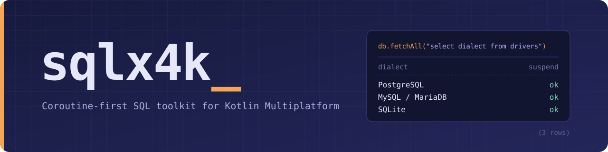

# sqlx4k


[](http://kotlinlang.org)


A coroutine-first SQL toolkit with compile-time query validations for Kotlin Multiplatform. PostgreSQL, MySQL/MariaDB,
and SQLite are supported.

<p align="center"></p>

---

**sqlx4k** is not an ORM. Instead, it provides a comprehensive toolkit of primitives and utilities to communicate
directly with your database. The focus is on giving you control while catching errors early through compile-time query
validation—preventing runtime surprises before they happen
(see [Validation](https://smyrgeorge.github.io/sqlx4k/codegen/validation/) for more details).

The library is designed to be extensible, with a growing ecosystem of tools and extensions like PGMQ (PostgreSQL Message
Queue), SQLDelight integration, and more.

📖 [Documentation](https://smyrgeorge.github.io/sqlx4k/) · 📚 [API reference](https://smyrgeorge.github.io/sqlx4k/api/)

#### 📰 Articles

Short deep‑dive posts covering Kotlin/Native, FFI, and Rust ↔ Kotlin interop used in sqlx4k:

- *Introduction to the Kotlin Native and FFI:*
  [[Part 1]](https://smyrgeorge.github.io/posts/sqlx4k---introduction-to-the-kotlin-native-and-ffi-part-1/),
  [[Part 2]](https://smyrgeorge.github.io/posts/sqlx4k---introduction-to-the-kotlin-native-and-ffi-part-2/)
- *Interoperability between Kotlin and Rust, using FFI:*
  [[Part 1]](https://smyrgeorge.github.io/posts/sqlx4k---interoperability-between-kotlin-and-rust-using-ffi-part-1/),
  (Part 2 soon)

## Usage

```kotlin
implementation("io.github.smyrgeorge:sqlx4k-postgres:1.17.0")
// or for MySQL
implementation("io.github.smyrgeorge:sqlx4k-mysql:1.17.0")
// or for SQLite
implementation("io.github.smyrgeorge:sqlx4k-sqlite:1.17.0")
// or for SQLite with encryption (SQLCipher)
implementation("io.github.smyrgeorge:sqlx4k-sqlite-cipher:1.17.0")
```

Or let the [Gradle plugin](https://smyrgeorge.github.io/sqlx4k/getting-started/gradle-plugin/) add the driver and set up
the code generation for you:

```kotlin
plugins {
    kotlin("multiplatform") // or kotlin("jvm")
    id("io.github.smyrgeorge.sqlx4k") version "1.17.0"
}

sqlx4k {
    driver = PostgreSQL // also: MySQL, MariaDB, SQLite, SQLiteCipher
    generatedCodePackage = "com.example.generated"
}
```

## Showcase

> [!NOTE]
> The repository implementations, the CRUD queries and the row mappers below are not written by hand: sqlx4k
> generates them at build time with [KSP](https://kotlinlang.org/docs/ksp-overview.html), from your `@Table` and
> `@Repository` declarations. See [Code generation](https://smyrgeorge.github.io/sqlx4k/codegen/).

Map a data class to a table with `@Table`:

```kotlin
@Table("users")
data class User(
    @Id
    val id: Long = 0, // Generated by the database, and read back on insert.
    val name: String,
    @Column(name = "mail_address")
    val email: String,
    @Version
    val version: Long = 0, // Optimistic locking, managed by the generated code.
)
```

Declare a `@Repository`: the code generator writes its implementation, `UserRepositoryImpl`, with the CRUD operations
(`insert`, `update`, `delete`, `save`, `batchInsert`, `batchUpdate`) and your `@Query` methods:

```kotlin
@Repository
interface UserRepository : CrudRepository<User> {
    @Query("SELECT * FROM users WHERE mail_address = :email")
    suspend fun findOneByEmail(context: QueryExecutor, email: String): Result<User?>

    @Query("SELECT * FROM users WHERE name = :name")
    suspend fun findAllByName(context: QueryExecutor, name: String): Result<List<User>>

    @Query("SELECT count(*) FROM users")
    suspend fun countAll(context: QueryExecutor): Result<Long>
}
```

Use it with the database, a connection or a transaction:

```kotlin
val db = PostgreSQL(url = "postgresql://localhost:15432/test", username = "postgres", password = "postgres")

db.transaction {
    val alice = UserRepositoryImpl.insert(this, User(name = "Alice", email = "alice@example.com")).getOrThrow()
    UserRepositoryImpl.update(this, alice.copy(name = "Alice Smith")).getOrThrow() // version 0 -> 1
}

val alice: User? = UserRepositoryImpl.findOneByEmail(db, "alice@example.com").getOrThrow()
```

Or, with [context parameters](https://kotlinlang.org/docs/context-parameters.html), extend `ContextCrudRepository`
instead, and the `QueryExecutor` is taken from the scope rather than passed to every call:

```kotlin
@Repository
interface UserRepository : ContextCrudRepository<User> {
    @Query("SELECT * FROM users WHERE mail_address = :email")
    context(context: QueryExecutor)
    suspend fun findOneByEmail(email: String): Result<User?>
}

db.transaction {
    // Every call in the block runs in the transaction.
    val alice = UserRepositoryImpl.insert(User(name = "Alice", email = "alice@example.com")).getOrThrow()
    UserRepositoryImpl.update(alice.copy(name = "Alice Smith")).getOrThrow()
}

with(db) {
    val alice: User? = UserRepositoryImpl.findOneByEmail("alice@example.com").getOrThrow()
}
```

Every `@Query` is checked while the code is generated, so a broken query fails the build instead of failing at
runtime:

```kotlin
@Query("SELECT * FROM users WHERE emial = :email") // Fails the build: `emial` is not a column of `User`.
suspend fun findOneByEmail(context: QueryExecutor, email: String): Result<User?>
```

See [Repositories](https://smyrgeorge.github.io/sqlx4k/codegen/repositories/),
[Entities](https://smyrgeorge.github.io/sqlx4k/codegen/entities/) and
[Validation](https://smyrgeorge.github.io/sqlx4k/codegen/validation/) for the details.

## Features

- [Supported databases](https://smyrgeorge.github.io/sqlx4k/databases/postgresql/): PostgreSQL, MySQL, MariaDB, SQLite
  and SQLCipher (encrypted SQLite)
- [Gradle plugin](https://smyrgeorge.github.io/sqlx4k/getting-started/gradle-plugin/)
- [Async I/O & coroutines](https://smyrgeorge.github.io/sqlx4k/guide/)
- [Connection pool and settings](https://smyrgeorge.github.io/sqlx4k/guide/connection-pool/)
- [Running queries](https://smyrgeorge.github.io/sqlx4k/guide/queries/): `execute`, `executeWithResult`, `fetchAll`,
  `fetch` (streaming), prepared statements
- [Row mappers and custom value converters](https://smyrgeorge.github.io/sqlx4k/guide/mapping/)
- [Transactions](https://smyrgeorge.github.io/sqlx4k/guide/transactions/), savepoints and `TransactionContext`
  (coroutines)
- [Database migrations](https://smyrgeorge.github.io/sqlx4k/guide/migrations/)
- [Code generation](https://smyrgeorge.github.io/sqlx4k/codegen/): CRUD and `@Repository` implementations
    - [Repositories](https://smyrgeorge.github.io/sqlx4k/codegen/repositories/): generated CRUD operations and `@Query` methods
    - [Entities](https://smyrgeorge.github.io/sqlx4k/codegen/entities/): `@Column`, `@Transient`, optimistic locking
      with `@Version`, `@Converter`
    - [Batch operations](https://smyrgeorge.github.io/sqlx4k/codegen/batch-operations/)
    - [Context parameters](https://smyrgeorge.github.io/sqlx4k/codegen/context-parameters/)
    - [Repository hooks](https://smyrgeorge.github.io/sqlx4k/codegen/hooks/)
    - [Compile-time SQL validation and query optimizations](https://smyrgeorge.github.io/sqlx4k/codegen/validation/)
    - [In-memory repositories (for unit testing)](https://smyrgeorge.github.io/sqlx4k/codegen/in-memory-repositories/)
- Extensions
    - [PostgreSQL LISTEN/NOTIFY](https://smyrgeorge.github.io/sqlx4k/databases/postgresql/#listen-notify)
    - [PostgreSQL Message Queue (PGMQ)](https://smyrgeorge.github.io/sqlx4k/extensions/pgmq/)
    - [SQLDelight](https://smyrgeorge.github.io/sqlx4k/extensions/sqldelight/)
- [Supported targets](https://smyrgeorge.github.io/sqlx4k/platforms/): JVM, Android, iOS, macOS, Linux, Windows

## Examples

Full runnable applications, built with the Gradle plugin:

- PostgreSQL: [examples/postgres](./examples/postgres)
- MySQL: [examples/mysql](./examples/mysql)
- SQLite: [examples/sqlite](./examples/sqlite)

## Contributing

See [Building](https://smyrgeorge.github.io/sqlx4k/contributing/building/) for how to build the project (it needs the
Rust toolchain), and the
[Roadmap](https://smyrgeorge.github.io/sqlx4k/contributing/roadmap/) for what is coming next; contributions are welcome.

The documentation lives in [docs](./docs) and is published with [Zensical](https://zensical.org/) on every release.

## Acknowledgements

sqlx4k stands on the shoulders of excellent open-source projects, such as [sqlx](https://github.com/launchbadge/sqlx),
r2dbc, [sqlite-jdbc](https://github.com/xerial/sqlite-jdbc), [SQLCipher](https://www.zetetic.net/sqlcipher/),
[JSqlParser](https://github.com/JSQLParser/JSqlParser) and [Apache Calcite](https://calcite.apache.org/): see the
[full list](https://smyrgeorge.github.io/sqlx4k/acknowledgements/).

## License

MIT — see [LICENSE](./LICENSE).
